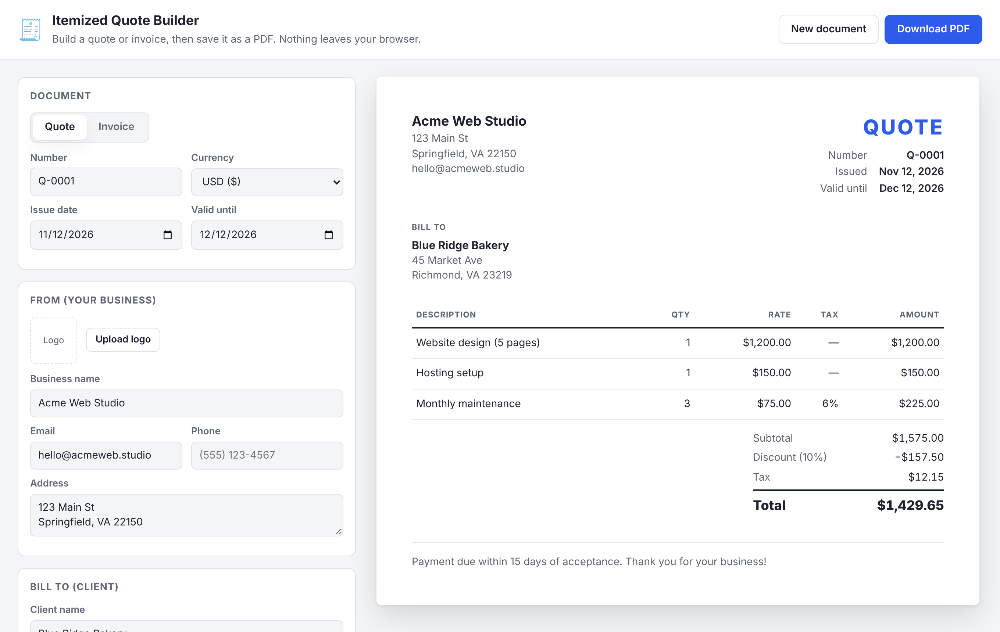

# 🧾 Itemized Quote Builder

A free, no-signup quote and invoice builder for small businesses. Add line items, see the totals update live, and download a clean PDF in one click.

It's plain HTML, CSS and JavaScript, with no frameworks, no build step and no server. **Everything stays in your browser.**



**▶ Live demo:** `https://enrichado-ai.github.io/wokrflow-itemized-builder/` *(available once GitHub Pages is turned on, see [Deploy](#deploy-to-github-pages))*

---

## Features

- **Quote or invoice.** Switch with one click. The title, number prefix (`Q-` / `INV-`) and "Valid until" / "Due date" label change with it.
- **Itemized line items.** Each has a description, quantity, rate and its own tax %.
- **Live totals.** Subtotal, an optional % discount (taken off before tax), tax and total.
- **PDF export.** Uses the browser's built-in "Save as PDF". The file is named for you (e.g. `Invoice - INV-0001 - Client Co.pdf`).
- **Saved clients.** Save a client once, then pick them from a dropdown on any future quote or invoice.
- **Auto-numbering.** "New document" moves to the next number for you (`Q-0001` → `Q-0002`, `INV-0099` → `INV-0100`).
- **Your branding.** Upload a logo and add your business details.
- **8 currencies.** USD, EUR, GBP, CAD, AUD, MXN, INR and JPY, formatted correctly for each.
- **Autosave.** Your work is kept in the browser (localStorage). "New document" keeps your business details, logo and saved clients.
- **Mobile friendly** and supports dark mode for the editor.
- **Private by design.** No accounts, no tracking, no data sent anywhere.

## Quick start

No install needed:

1. Download or clone this repo.
2. Open `index.html` in any modern browser.

```bash
git clone https://github.com/enrichado-ai/wokrflow-itemized-builder.git
cd wokrflow-itemized-builder
open index.html        # macOS  (Windows: start index.html, Linux: xdg-open index.html)
```

## How to use

1. Choose **Quote** or **Invoice** and set the number and dates.
2. Fill in **From** (your business) and **Bill to** (your client). Click **Save client** to reuse them next time.
3. Add **line items**. New rows copy the tax rate of the row above.
4. Optionally add a **discount** and **notes / payment terms**.
5. Click **Download PDF**, then choose **Save as PDF** in the print dialog.

## How totals are calculated

| Value     | Formula                                          |
|-----------|--------------------------------------------------|
| Line amount | `qty × rate` (rounded to cents)                |
| Subtotal  | sum of line amounts                              |
| Discount  | `subtotal × discount %`                          |
| Tax       | sum of each line's `amount × tax %`, reduced by the discount % |
| **Total** | `subtotal − discount + tax`                      |

This logic lives in [`calc.js`](calc.js) with no DOM code, so it's easy to test and reuse.

## Project structure

```
├── index.html          # Page layout: editor form + document preview
├── styles.css          # Styles, responsive layout and print (PDF) rules
├── app.js              # UI: form binding, line items, saved clients, preview, autosave
├── calc.js             # Pure logic: line totals, discount, tax, money formatting, numbering
├── tests/calc.test.js  # Unit tests (Node's built-in test runner)
└── docs/screenshot.png
```

## Running tests

Requires Node.js 18 or newer. There are no dependencies to install.

```bash
npm test
```

Tests also run automatically on every push through GitHub Actions.

## Deploy to GitHub Pages

1. Open the repo on GitHub and go to **Settings → Pages**.
2. Under **Build and deployment**, set **Source** to *Deploy from a branch*.
3. Pick your branch (e.g. `main`) and the `/ (root)` folder, then click **Save**.
4. After a minute your site will be live at `https://<your-username>.github.io/<repo-name>/`.

## Roadmap

Ideas for contributions are welcome:

- [x] Save multiple clients
- [x] Auto-incrementing document numbers
- [ ] Export / import a document as JSON
- [ ] Save a history of past documents
- [ ] Color theme picker for the PDF
- [ ] Per-line discounts and shipping fees
- [ ] "Pay now" link field (Stripe, PayPal, etc.)

## Contributing

1. Fork the repo and create a branch: `git checkout -b feature/my-idea`
2. Make your change and run `npm test`
3. Open a pull request describing what you changed and why

## License

[MIT](LICENSE). Free to use, change and share, including for commercial work.
